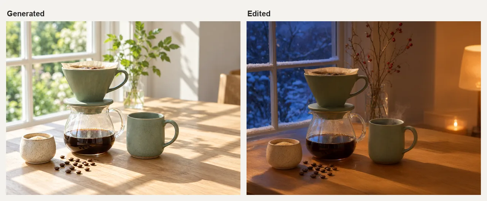

# AI Image Generator Skill

English | [简体中文](./README.zh-CN.md)

Generate, compose, and edit product images, brand visuals, posters, social graphics, illustrations, and photo variations, from inside Claude Code, Codex, or OpenClaw.

> [!IMPORTANT]
> Rendering needs a [Beatra](https://beatra.ai) account and uses credits. The skill itself is free to install.

| Question | Answer |
| --- | --- |
| **What it does** | Generate, compose, and edit product images, brand visuals, posters, social graphics, illustrations, and photo variations. |
| **Requirements** | Python 3.10+ and an agent that loads `SKILL.md` |
| **Cost** | Free to install. Each render uses credits on your Beatra account, and paid steps run only when you ask for that exact render or approve its card. |
| **Works with** | Claude Code, Codex, OpenClaw |

<p align="center"></p>

*A sunlit summer photo of a fictional sage-green ceramic pour-over coffee set, then the same image edited into a snowy winter evening with lamplight while the set and its layout stay in place. AI-generated with Beatra.*

| Skill | Entry point | Version |
| --- | --- | --- |
| [`ai-image-generation-studio`](skills/ai-image-generation-studio) | [SKILL.md](skills/ai-image-generation-studio/SKILL.md) | 0.2.2 |

This repository is published automatically from [beatra-ai/beatra-skills](https://github.com/beatra-ai/beatra-skills/tree/main/skills/ai-image-generation-studio). Report issues there.

## Install

With the [`skills`](https://skills.sh) CLI:

```bash
npx skills add beatra-ai/ai-image-generator-skill
```

With the GitHub CLI:

```bash
gh skill install beatra-ai/ai-image-generator-skill ai-image-generation-studio
```

Or clone this repository and copy `skills/ai-image-generation-studio` into `~/.claude/skills/` for Claude Code,
`~/.agents/skills/` for Codex, or `~/.openclaw/skills/` for OpenClaw.

Or paste this into your agent:

```text
Install the ai-image-generation-studio skill from https://github.com/beatra-ai/ai-image-generator-skill (folder skills/ai-image-generation-studio), then follow its SKILL.md to connect my Beatra account.
```

## Examples

<p align="center"></p>

*The generated pour-over set used as a reference for a new composition: a square overhead flat lay on linen with beans, a paper filter and a brass scoop. AI-generated with Beatra.*

Prompt:

```text
New composition for a square social media post. Image 1 is the product reference: the sage-green ceramic pour-over dripper, the glass carafe, the sage-green mug and the speckled cream sugar bowl. Keep their shapes, glaze colors, speckled texture and proportions recognizable. Arrange them as a top-down overhead flat lay on a textured natural linen tablecloth: the dripper lying beside the carafe, the mug filled with black coffee seen from directly above, the sugar bowl, a small scattered line of whole coffee beans, a folded unbleached paper filter, and a brass coffee scoop. Soft even daylight from the upper left with gentle short shadows, calm balanced spacing between objects with breathing room around the edges, muted sage, cream, linen and warm brown palette, photoreal editorial product photography. No people, no hands, no text, no logos, no labels, no watermarks.
```

## Specs

As of 2026-10-16. Live list: https://docs.beatra.ai/en/docs/models

- **Text to image** — 10 models (Qwen Image 2.0 Fast, Qwen Image 3.0, Qwen Image 3.0 Pro, GPT Image 2.5 Flare, GPT Image 2.5 Sunburst, GPT Image 2, Wan Image 2.7 Fast, Qwen Image 2.0 Pro, Wan Image 2.7 Pro, MiniMax Image 01 Live); up to 4 images per request; canvas up to 16777216 pixels
- **Image to image** — 10 models (Qwen Image 2.0 Fast, Qwen Image 3.0, Qwen Image 3.0 Pro, Wan Image 2.7 Fast, Qwen Image 2.0 Pro, Wan Image 2.7 Pro, GPT Image 2.5 Flare, GPT Image 2.5 Sunburst, GPT Image 2, MiniMax Image 01 Live); up to 4 images per request; canvas up to 16777216 pixels
- **Image editing** — 6 models (Qwen Image 2.0 Fast, Qwen Image 3.0, Qwen Image 3.0 Pro, Wan Image 2.7 Fast, Qwen Image 2.0 Pro, Wan Image 2.7 Pro); up to 4 images per request; canvas up to 4194304 pixels
- **Image to video** — 9 models (wan2.7-i2v, wan3.0-video, minimax-h3, seedance-2-mini, happyhorse-1.1-i2v, seedance-2-fast, seedance-2, wan3.0-video-prime, seedance-2.5); 480p to 4K; 2–30 s; aspect ratios 16:9, 1:1, 21:9, 3:4, 4:3, 9:16; MOV, MP4; 2 with native audio

## How it compares

| | Beatra (this skill) | [wuyoscar/GPT-Image2-Skill](https://github.com/wuyoscar/GPT-Image2-Skill) | [black-forest-labs/skills](https://github.com/black-forest-labs/skills) |
| --- | --- | --- | --- |
| Account or key needed | A Beatra account; no model provider keys | Your own OPENAI_API_KEY ([source](https://github.com/wuyoscar/GPT-Image2-Skill/blob/9f8aa1a44a4a5c0f5a5d6e45eed564b3e2d5b87f/README.md#L338)) | A BFL API key ([source](https://github.com/black-forest-labs/skills/blob/8907d515b0ac270a988ec7a239add81ee13d6cba/README.md#L160-L166)) |
| Models | Text to image 10; Image to image 10; Image editing 6; Image to video 9 | OpenAI GPT Image 2, GPT Image 2.5 Flare and Sunburst ([source](https://github.com/wuyoscar/GPT-Image2-Skill/blob/9f8aa1a44a4a5c0f5a5d6e45eed564b3e2d5b87f/README.md#L154-L160)) | FLUX.2 and FLUX.1 models ([source](https://github.com/black-forest-labs/skills/blob/8907d515b0ac270a988ec7a239add81ee13d6cba/README.md#L127-L137)) |
| Before spending | Paid renders run only when you ask for that exact render or approve its card, which shows the live credit estimate | Asks before switching models or adding outputs; confirms the model only when unclear; suggests low-quality drafts first ([source](https://github.com/wuyoscar/GPT-Image2-Skill/blob/9f8aa1a44a4a5c0f5a5d6e45eed564b3e2d5b87f/README.md#L162-L164)) | Lists per-model prices, e.g. FLUX.2 [klein] from $0.014/image, [pro] from $0.03/MP; [dev] free for non-commercial use ([source](https://github.com/black-forest-labs/skills/blob/8907d515b0ac270a988ec7a239add81ee13d6cba/README.md#L127-L135)) |
| Agents | Claude Code, Codex, OpenClaw | Claude Code, Codex, OpenClaw, Hermes Agent ([source](https://github.com/wuyoscar/GPT-Image2-Skill/blob/9f8aa1a44a4a5c0f5a5d6e45eed564b3e2d5b87f/README.md#L39)) | Coding agents (skills follow the agentskills.io spec); also a Claude Code plugin ([source](https://github.com/black-forest-labs/skills/blob/8907d515b0ac270a988ec7a239add81ee13d6cba/README.md#L16-L68)) |
| Install | `npx skills add beatra-ai/ai-image-generator-skill` | Claude Code plugin marketplace, or Codex's skill installer ([source](https://github.com/wuyoscar/GPT-Image2-Skill/blob/9f8aa1a44a4a5c0f5a5d6e45eed564b3e2d5b87f/README.md#L219-L229)) | `npx skills add black-forest-labs/skills` ([source](https://github.com/black-forest-labs/skills/blob/8907d515b0ac270a988ec7a239add81ee13d6cba/README.md#L29)) |
| License | MIT-0 | MIT ([source](https://github.com/wuyoscar/GPT-Image2-Skill/blob/9f8aa1a44a4a5c0f5a5d6e45eed564b3e2d5b87f/LICENSE)) | MIT ([source](https://github.com/black-forest-labs/skills/blob/8907d515b0ac270a988ec7a239add81ee13d6cba/LICENSE)) |
| Last updated | Updated with every release (v0.2.2) | 2026-09-30 ([source](https://github.com/wuyoscar/GPT-Image2-Skill/commit/9f8aa1a44a4a5c0f5a5d6e45eed564b3e2d5b87f)) | 2026-08-26 ([source](https://github.com/black-forest-labs/skills/commit/8907d515b0ac270a988ec7a239add81ee13d6cba)) |

Facts checked on 2026-10-16. Corrections: open an issue in [beatra-ai/beatra-skills](https://github.com/beatra-ai/beatra-skills/issues).

## What you get

- **Direction before generation** — Define the message, subject, composition, style, light, color, destination, and must-keeps before creating.
- **Start from the source that matters** — Use a written brief, one to four ordered reference images, or one base image while keeping your chosen starting point clear.
- **Review before another version** — Inspect the generated image, then choose one focused edit, new composition, or new generation.

## Use cases

- **Create product images** — Place a supplied product into a new scene or generate a new product concept, then check shape, color, label, and destination fit.
- **Build ad and brand visuals** — Turn one message, palette, and audience into a campaign image or brand-led visual draft.
- **Make social graphics and posters** — Plan one image around the channel, orientation, room for text, and message.
- **Develop illustrations and concepts** — Explore a named visual style for an illustration, cover, scene, or concept image.
- **Change a photo or background** — Use an existing image as the base and focus the requested change on an object, region, background, or overall treatment, then inspect the whole result.
- **Compose from reference images** — Use ordered product, subject, style, or scene references to guide a new image, then check what carried through.

## FAQ

### What can AI Image Generation Studio make?

It can create product images, ad creative, brand visuals, posters, social graphics, illustrations, concept art, photo variations, and background changes from text, references, or an existing base image.

### Can it use my own photos or product images?

Yes. One to four supplied images can guide a new composition, or the first supplied image can remain the base for an edit. Generated details still need review.

### Can it change only part of an image?

Yes. A focused edit targets a defined area of an existing base image, then reviews the whole result for subject, composition, text, and destination fit.

### Which image models does it use?

It matches the image goal, reference materials, canvas, output count, and creative controls with current models, and keeps a named model when it fits those inputs.

### Can it keep a series consistent?

It reuses the selected direction, wording, reference images, subject cues, style, logo placement, and text plan across the series, then reviews each result for visual consistency.

## Updates and security

Since the 2026-10 release, this skill contains no self-updater: it runs only the
files you installed and never replaces them on its own. Update it with the tool
you installed it with — `npx skills update ai-image-generation-studio` or `gh skill update ai-image-generation-studio`.
Details: `references/updates-and-security.md` inside the skill.

## License

[MIT-0](LICENSE) — free to use, modify, and redistribute, including
commercially. No attribution required. Same terms as these skills carry on
ClawHub.

## Links

- Website — https://beatra.ai
- Docs — https://docs.beatra.ai
- Console — https://console.beatra.ai
